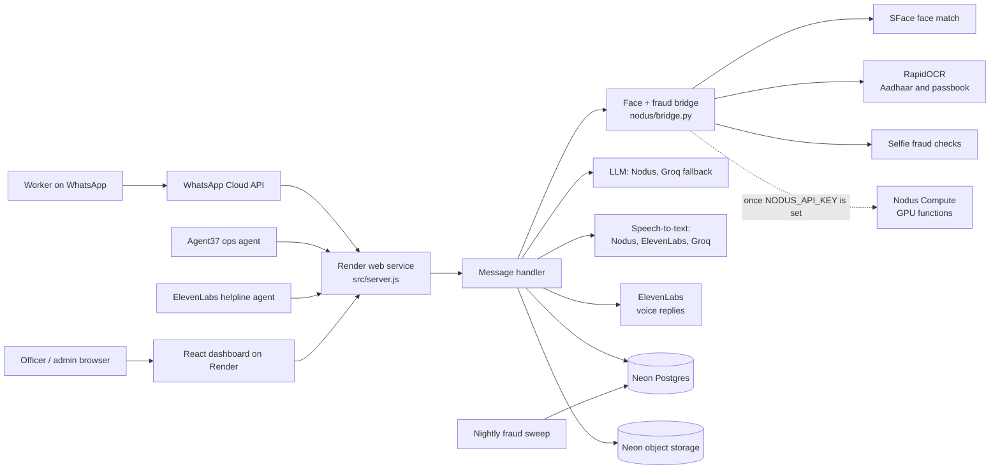

# Nirman Mitra

**Voice-first WhatsApp assistant that helps construction workers build verifiable proof of work days, and lets welfare board officers verify that proof.**

Workers check in daily with a selfie, their location, and a voice note. Each check-in is verified by three independent checks: face, geo-fence, and voice intent, plus fraud signals on the selfie and location. Verified days add up to a digitally signed work certificate that an officer can check by scanning a QR code. See [PRD.md](PRD.md) for the full product requirements.

### Core Innovation: Triple Verification

Every attendance log is verified through independent channels at the same time:

| Channel | What does it | What it catches |
|---|---|---|
| **Face match** | OpenCV YuNet + SFace on the face bridge (CPU). Amazon Rekognition is still available as an option | Buddy-punching, fake identities |
| **Geo-fence** | GPS + site matching | Off-site check-ins, spoofing |
| **Voice intent** | Speech-to-text (Nodus Whisper, ElevenLabs Scribe, Groq Whisper, in that order), then an LLM (Nodus `gpt-oss-120b`, Groq as fallback) that also checks a spoken passcode | Fake check-ins, scripted messages, unintelligible audio |
| **Fraud signals** | Perceptual hashing and a screen-recapture check on every selfie; a nightly sweep over all check-ins | Re-sent gallery selfies, photos of screens, mock GPS, impossible travel, phone farms, one person under two numbers |

Registration also reads the worker's **Aadhaar card** with RapidOCR on the bridge. The photo is read in memory on our own server, never stored, and only the last 4 digits are kept.

## Hackyard Build 2026: Sponsor Integrations

| Sponsor | What it does in Nirman Mitra | Status today | Code |
|---|---|---|---|
| **Nodus Compute** | LLM and speech-to-text on Nodus inference; a GPU `analyze_selfie` function (pHash + DINOv2 near-duplicates) and the same face model on a GPU; a nightly fraud-sweep job | Built and tested against fakes. It switches on by adding `NODUS_API_KEY`; until then the same work runs on Groq and on the bridge's CPU. Not yet run on real Nodus | [`nodus/`](nodus/), [`src/providers/llm.js`](src/providers/llm.js), [`src/providers/stt.js`](src/providers/stt.js), [`src/services/fraudSignals.js`](src/services/fraudSignals.js) |
| **ElevenLabs** | Spoken replies in every language that has a voice id configured; Scribe as the second speech-to-text; the "Mitra Helpline" voice agent for workers | Voice replies work. Kannada needs a Kannada voice id in `ELEVENLABS_VOICE_IDS` (Hindi and English are set up). The helpline agent is documented, not yet created | [`src/providers/tts.js`](src/providers/tts.js), [`agents/elevenlabs/`](agents/elevenlabs/), [`src/handlers/helplineRoutes.js`](src/handlers/helplineRoutes.js) |
| **Agent37** | An always-on Welfare Ops Agent: AI triage notes on the review queue (recommendations only), a daily officer digest, a weekly welfare-scheme refresh | API and scripts are built and tested; the Agent37 instance is yet to be created | [`agents/agent37/`](agents/agent37/), [`src/handlers/agentRoutes.js`](src/handlers/agentRoutes.js) |

More detail: [docs/SPONSOR_PLAN.md](docs/SPONSOR_PLAN.md) (plan and demo script), [docs/RENDER_NEON.md](docs/RENDER_NEON.md) (hosting), [docs/NODUS_SWITCH.md](docs/NODUS_SWITCH.md) (running before Nodus access and switching over).

### The Four Zeros

| Principle | How |
|---|---|
| **Zero Literacy** | Voice-first: WhatsApp voice notes in, ElevenLabs spoken replies out (or native text) |
| **Zero Downloads** | WhatsApp only, no app installation |
| **Zero Contractor Dependency** | AI self-verification replaces employer sign-off |
| **Zero Typing** | Voice input and camera. Typing is only a fallback |

## Architecture



### Deliberate Architectural Decisions

| Decision | Choice | Why not the alternative |
|---|---|---|
| **Database** | Postgres (Neon, or Render Postgres) | The data helpers keep DynamoDB's API and expressions (`src/utils/postgres.js`), so `DB_BACKEND=dynamodb` still runs the old Lambda stack. Neon's free tier needs no card |
| **Files** | S3-compatible object storage (Neon), or the API's disk | A free Render service has no disk and loses files on every restart. Object storage keeps selfies and certificates (path-style URLs, see `src/utils/s3.js`) |
| **Compute** | Render web service | One always-on Node process runs the same handlers as the Lambda stack, with no per-function packaging |
| **Faces** | OpenCV YuNet + SFace on the bridge | Free, ~40 MB, CPU only, and the same model runs on Nodus later, so stored embeddings stay valid. Rekognition needs an AWS account |
| **Document OCR** | RapidOCR (PaddleOCR models on ONNX Runtime) on the bridge | Tesseract could not read a real Aadhaar card photo; RapidOCR reads it correctly, in any orientation, and the image still never leaves our server. Textract needs AWS; sending cards to a vision LLM would break the privacy rule |
| **LLM and speech-to-text** | Nodus first, Groq as the fallback | Providers share one interface, and a missing Nodus key means Groq is used directly, with no wasted failed calls |
| **Voice replies** | ElevenLabs | Polly has no Kannada voice |

### Cost Analysis

The demo runs on free tiers; check each provider's current limits before relying on them.

| Component | Cost profile |
|---|---|
| Render | Free web services sleep after ~15 minutes idle (the first request then takes up to ~50 s). Disks and cron jobs need a paid plan |
| Neon | Free plan for Postgres and object storage |
| Groq | Per-token API pricing, very low for this volume |
| ElevenLabs | Plan credits; replies are cached by content in object storage, so fixed messages are synthesised once |
| Face match and OCR | Run on the bridge's own CPU: no per-call cost |
| Nodus | Credits from the hackathon, used once access is granted |

### Where Things Run and Backend Switches

| Setting | Values | Default and notes |
|---|---|---|
| `DB_BACKEND` | `postgres` / `dynamodb` / `memory` | `memory` locally in demo mode |
| `STORAGE_BACKEND` | `s3` / `disk` / `memory` | Set `AWS_ENDPOINT_URL_S3` for S3-compatible stores such as Neon |
| `FACE_PROVIDER` | `bridge` / `rekognition` / `none` | `bridge` when `FRAUD_SERVICE_URL` and `FRAUD_SERVICE_TOKEN` are set. `none` sends every check-in to an officer. If the bridge is down, the day goes to review rather than being rejected |
| `OCR_PROVIDER` | `bridge` / `tesseract` / `textract` | `bridge` falls back to in-process Tesseract if the bridge fails |
| `LLM_PROVIDER` | `nodus` / `groq` | With no `NODUS_API_KEY`, `nodus` runs on Groq directly. `LLM_FALLBACK_PROVIDER` is tried once on a failure |
| `STT_PROVIDERS` | e.g. `nodus,elevenlabs,groq` | Providers without a key are skipped |
| `TTS_FALLBACK` | `none` / `polly` | Used only if ElevenLabs has no voice for the language |
| `FRAUD_BACKEND` (bridge) | `local` / `nodus` | `nodus` automatically once the bridge has `NODUS_API_KEY`; any Nodus failure falls back to `local` |

## Quick Start

### Prerequisites
- Node.js 22 (CI uses 22; the repo needs at least 20) and Python 3.12 for the bridge
- A WhatsApp Cloud API app (Meta developer console)
- Render account, plus Neon (both can run on their free plans); no AWS account
- Groq and ElevenLabs API keys. Nodus is optional until access is granted

### Configuration
Copy `.env.example` to `.env` and fill in your values. Never commit real secrets: `.env` is git-ignored. On Render the values are set per service.

### Deploy on Render

Follow **[docs/RENDER_NEON.md](docs/RENDER_NEON.md)**. It creates three services by hand, with no card needed on the free plan:

| Service | Type | Notes |
|---|---|---|
| Face + OCR + fraud bridge | Python web service, root directory `nodus` | Build command installs RapidOCR with `--no-deps`; `/health` should show `"ocr": true` |
| API | Node web service | `node src/server.js`, health check `/health`, `OCR_PROVIDER=bridge`, `FACE_PROVIDER=bridge` |
| Dashboard | Static site, root directory `admin-dashboard` | `VITE_API_URL` = the API URL; rewrite `/*` to `/index.html` |

`render.yaml` describes the full Blueprint (it also adds the reminders cron, the nightly sweep cron, a disk and Postgres); applying it needs a payment method.

**WhatsApp.** In the Meta app, under the WhatsApp use case → Configuration, set the callback URL to `https://<api host>/webhook/whatsapp`, use the same `WHATSAPP_VERIFY_TOKEN`, and subscribe to the `messages` field. Meta's quick "Generate access token" gives a short-lived token; create a system-user token that never expires before a demo. A test number can message only the recipients added under API Setup (up to 5).

**First admin.**
```bash
curl -X POST "$API_URL/api/auth/seed" \
  -H "Content-Type: application/json" \
  -d '{"email":"admin@example.com","password":"<strong-password>","name":"Admin","seedSecret":"<ADMIN_SEED_SECRET>"}'
```

**Demo data.** Add the venue under Sites in the dashboard, or seed it with `scripts/seed-sites.mjs`; the fraud scenarios come from `scripts/seed-fraud-demo.mjs`.

**Adaption Visualize.** The dashboard's *Explore in Adaption Visualize* card downloads pseudonymised check-in and fraud datasets (`/api/admin/export/*.csv`, with no names, phone numbers, Aadhaar details or GPS) to upload to [Adaption Visualize](https://www.adaptionlabs.ai/).

### Switching on Nodus
When Nodus access arrives, add `NODUS_API_KEY` to the API and the bridge, deploy `nodus/app.py`, and move the sweep to its Nodus job. Steps: [docs/NODUS_SWITCH.md](docs/NODUS_SWITCH.md). Remove the key to roll back.

### Run Locally

```bash
npm install
ENVIRONMENT=prod node --env-file=.env src/server.js   # API on :3001
# ENVIRONMENT=dev uses demo mode: the face, GPS and voice checks are simulated

cd nodus
pip install -r requirements-bridge.txt && pip install --no-deps rapidocr-onnxruntime
FRAUD_SERVICE_TOKEN=<same token> uvicorn bridge:app --port 8080

cd admin-dashboard && npm install && npm run dev      # proxies /api and /webhook to :3001
```

A real WhatsApp number cannot reach a laptop, so local runs use a stand-in for WhatsApp's servers (set `WHATSAPP_API_URL`).

### Tests

```bash
npm test                                   # Node 22; on Node 20 run: node --test tests/*.test.mjs
npm run lint
pip install numpy pillow pytest fastapi httpx
python -m pytest nodus/tests agents/agent37/tests
```

CI (`.github/workflows/ci.yml`) runs the Node tests and lint, the Python tests, and the dashboard build on every push.

### Demo Mode

The project runs in demo mode when `ENVIRONMENT=dev` and it is not hosted (Render sets its own variable, so it never applies there):
- **Demo keywords:** the team phone numbers in `DEMO_PHONE_NUMBERS` can trigger quick demo paths.
- **Certificate threshold:** set to **3 days** (instead of 90) for quick demonstrations.
- **Simulated checks:** face, GPS and voice results are simulated.

## Project Structure

```
nirman-mitra/
  ├── PRD.md                    # Product requirements and specs
  ├── render.yaml               # Render Blueprint (optional; docs/RENDER_NEON.md is the manual route)
  ├── template.yaml             # AWS SAM template, the Lambda stack kept as a standby
  ├── docs/                     # SPONSOR_PLAN, RENDER_NEON, NODUS_SWITCH
  ├── nodus/                    # Face + OCR + fraud bridge (bridge.py), face.py (SFace), ocr.py (RapidOCR),
  │                             #   fraud_core.py, Nodus function app.py, nightly sweep.py and its job
  ├── agents/
  │   ├── agent37/              # Agent37 Welfare Ops Agent (triage, digest, instructions)
  │   └── elevenlabs/           # ElevenLabs Mitra Helpline agent config + tool
  ├── scripts/                  # Site seeding and fraud demo data
  ├── src/
  │   ├── server.js             # HTTP server for Render; runs the handlers below unchanged
  │   ├── handlers/             # Webhook, attendance, certificates, admin, agent and helpline APIs
  │   ├── services/             # Registration, document OCR, voice, fraud signals, consent, audit
  │   ├── providers/            # llm.js, stt.js, tts.js, face.js
  │   ├── middleware/auth.js    # JWT verification for the admin API
  │   └── utils/                # Config, Postgres/DynamoDB helpers, object storage, WhatsApp client
  ├── tests/                    # Node tests (170+), run against fakes of every external service
  └── admin-dashboard/          # React + Vite admin dashboard, officer portal and verify page
```

## Security & Privacy
- **Aadhaar:** the card photo is read in memory on our own bridge and never stored. Only the last 4 digits are kept, and no Aadhaar image or number goes to any outside AI service.
- **Selfies and files:** kept in private object storage and shown through short-lived signed links.
- **GPS:** each check-in stores an ~11 m cell and a keyed hash of the exact fix, never the raw coordinates.
- **Agents are limited:** the Agent37 API shows masked data only, can only add recommendations (it cannot approve or reject), and every call is audit-logged. The helpline identifies a worker by caller number, so it cannot look up anyone else.
- **Webhooks and APIs:** WhatsApp requests are checked against Meta's signature; the admin API needs a JWT; the bridge needs a shared token; agent endpoints use hashed keys.
- **Audit log:** officer and admin views and decisions are recorded in an append-only log.
- **Consent:** workers see a purpose notice and agree before any data is collected.

### Known limits
- No liveness check: a photo of a photo could pass the face step. The screen-recapture and near-duplicate checks and the spoken passcode partly cover it.
- Face-score cut-offs and fraud thresholds came from a few test photos and need calibrating on real selfies.
- Until Nodus is switched on, a cropped or edited copy of an old selfie is not detected; only identical re-sends are.
- Free Render services sleep when idle, so warm them up (`/health`) before a demo.

## Team

**StrawHats** | Hackyard Build 2026