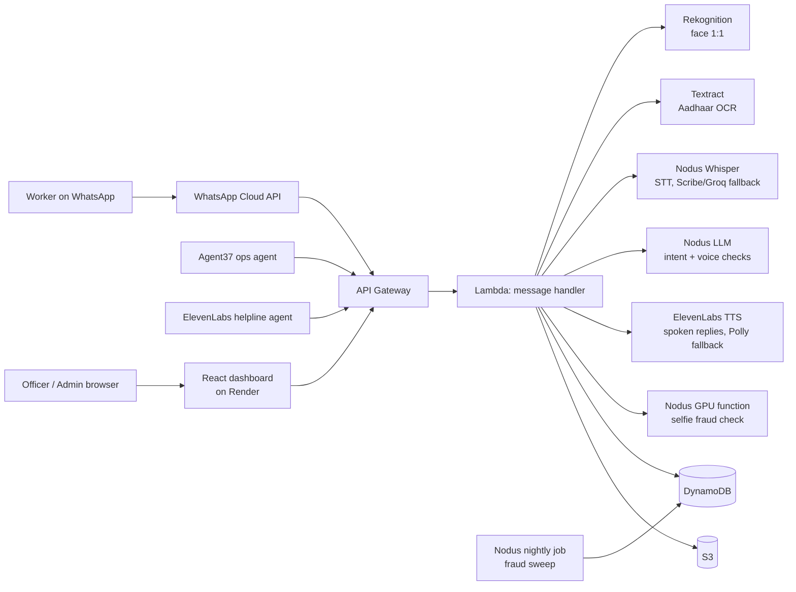

# Nirman Mitra

**Voice-first WhatsApp assistant that helps construction workers build verifiable proof of work days, and lets welfare board officers verify that proof.**

Workers check in daily with a selfie, their location, and a voice note. Each check-in is verified by three independent checks: face, geo-fence, and voice intent. Verified days add up to a digitally signed work certificate. See [PRD.md](PRD.md) for the full product requirements.

### Core Innovation: Triple Verification

Every attendance log is verified through three independent AI channels simultaneously:

| Channel | AI/Cloud Service | What It Catches |
|---|---|---|
| **Face Match** | Amazon Rekognition | Buddy-punching, fake identities |
| **Geo-Fence** | GPS + Site matching | Off-site check-ins, spoofing |
| **Voice Intent** | Nodus inference (Whisper + gpt-oss-120b), Groq fallback | Fake check-ins, scripted messages, unintelligible audio |
| **Fraud signals** | Nodus Compute (GPU function + nightly job) | Re-sent gallery selfies, photos of screens, mock GPS, phone farms, one person under two numbers |

## Hackyard Build 2026: Sponsor Integrations

| Sponsor | What it does in Nirman Mitra | Code |
|---|---|---|
| **Nodus Compute** | LLM and speech-to-text on Nodus inference. A GPU `analyze_selfie` function on every check-in (pHash + DINOv2 near-duplicate, FaceNet, screen recapture). A nightly fraud-sweep job for mock GPS, impossible travel, phone farms and shared faces | [`nodus/`](nodus/), [`src/providers/llm.js`](src/providers/llm.js), [`src/providers/stt.js`](src/providers/stt.js), [`src/services/fraudSignals.js`](src/services/fraudSignals.js) |
| **ElevenLabs** | Spoken replies in every language with a voice, **including Kannada** (Polly has none). Scribe as STT fallback. The "Mitra Helpline" voice agent on WhatsApp/phone, with its LLM on Nodus | [`src/providers/tts.js`](src/providers/tts.js), [`agents/elevenlabs/`](agents/elevenlabs/), [`src/handlers/helplineRoutes.js`](src/handlers/helplineRoutes.js) |
| **Agent37** | An always-on Welfare Ops Agent: AI triage notes on the review queue (recommendations only), a daily officer digest, and a weekly welfare-scheme refresh for the helpline | [`agents/agent37/`](agents/agent37/), [`src/handlers/agentRoutes.js`](src/handlers/agentRoutes.js) |

See [docs/SPONSOR_PLAN.md](docs/SPONSOR_PLAN.md) for the plan and demo script.

### The Four Zeros

| Principle | How |
|---|---|
| **Zero Literacy** | Voice-first via WhatsApp voice notes + Amazon Polly TTS (or native text) |
| **Zero Downloads** | WhatsApp only — no app installation required |
| **Zero Contractor Dependency** | AI self-verification replaces employer sign-off |
| **Zero Typing** | Voice input + camera — no text entry required |

## Architecture



### Deliberate Architectural Decisions

| Decision | Choice | Why Not Alternative |
|---|---|---|
| **Database** | DynamoDB | RDS adds VPC cold starts and fixed costs; DynamoDB scales to zero. |
| **Compute** | Render web service + cron job | One always-on Node process (`src/server.js`) runs the same handlers with no cold starts; the Lambda stack stays deployable as a standby. |
| **Orchestration** | AWS Step Functions | SQS chaining loses state easily; Step Functions gives visual debugging and parallel branch execution. |
| **LLM & STT** | Groq (Whisper + Llama/GPT-OSS) | Amazon Transcribe was too slow (~10-20s polling). Groq Whisper transcribes in ~1 second. |
| **Frontend** | Render static site | Deploys from the same Blueprint (`render.yaml`) as the API, after CI passes. |

### Cost Analysis

| Component | Description | Cost Profile |
|---|---|---|
| Groq Whisper & LLM | Ultra-fast STT and Intent extraction | Extremely low cost / API tokens |
| Amazon DynamoDB | On-demand state management and logs | PAY_PER_REQUEST, scales to zero |
| AWS Lambda | Event-driven compute | Free tier covers most startup traffic |
| Amazon Rekognition | 1 `CompareFaces` per attendance log | ~$1.00 per 1,000 matches |
| Amazon Textract | Only during worker onboarding (Aadhaar/Passbook) | ~$1.50 per 1,000 pages |
| Amazon Polly | Text-to-Speech replies (Hindi, etc.) | Pay per character, heavily cached |

### AWS Services Utilized

- **Amazon Rekognition:** Facial verification (1:1 matching) + liveness/quality detection.
- **Amazon Textract:** OCR for Aadhaar and Bank Passbooks during onboarding.
- **Amazon Polly:** Neural TTS for voice replies in Indian languages.
- **Amazon S3:** Raw media, processed output, and generated PDF certificates.
- **Amazon DynamoDB:** User state, attendance logs, and site definitions.
- **AWS Lambda:** Serverless handlers for webhooks and business logic.
- **AWS Step Functions:** Asynchronous workflow orchestration.
- **Amazon SQS:** Decoupled webhook processing with Dead Letter Queues (DLQ).
- **Amazon API Gateway:** REST APIs for WhatsApp webhooks and Admin dashboard.
- **AWS KMS:** Encryption of sensitive data (like Aadhaar images).
- **AWS CloudFormation (SAM):** Infrastructure as Code (single `template.yaml`).
- **Render:** Hosts the API, the reminder cron job, the Nodus fraud bridge and the React dashboard (`render.yaml`).

## Quick Start

### Prerequisites
- Node.js 20+
- AWS CLI v2 and AWS SAM CLI
- WhatsApp Cloud API App (Meta Developer Console)
- Groq API Key

### Configuration
Copy `.env.example` to `.env` and fill in your values. Never commit real secrets. In AWS, these values are passed to the stack via SAM parameters (`NoEcho`).

### Deploy

The app runs on Render; the data (DynamoDB, S3) and the AI services stay on AWS.

**1. AWS stack (once, then on every `template.yaml` change).** Creates the tables, buckets and
the `RenderRuntimeUser` IAM user. The `Deploy AWS stack` workflow does this from GitHub; by hand:

```bash
sam build && sam deploy --guided
aws iam create-access-key --user-name <RenderRuntimeUserName output>
```

**2. Render.** In the Render dashboard choose **New → Blueprint**, pick this repo, and fill in the
secrets it asks for (the access key from step 1, the bucket names from the stack outputs, and the
values from `.env.example`). It creates four services from `render.yaml`:

| Service | What |
|---|---|
| `nirman-mitra-api` | WhatsApp webhook + all `/api/*` routes |
| `nirman-mitra-reminders` | Proactive reminders, every 15 minutes |
| `nirman-fraud-bridge` | Node → Nodus selfie fraud check |
| `nirman-mitra-admin` | Dashboard / officer portal (static) |

Then point things at the new URLs: `VITE_API_URL` (dashboard) = the API URL, `PORTAL_URL` and
`FRAUD_SERVICE_URL` (API) = the dashboard and bridge URLs. After that, every push to `main`
deploys once CI passes.

**3. WhatsApp.** In the Meta app set the callback URL to
`https://<nirman-mitra-api host>/webhook/whatsapp`, use the same `WHATSAPP_VERIFY_TOKEN`, and
subscribe to the `messages` field.

### Run Locally

```bash
npm install
node src/server.js          # API on :3001, in-memory demo store when ENVIRONMENT=dev

cd admin-dashboard
npm install
npm run dev                 # proxies /api and /webhook to :3001
```

### Create the First Admin User
```bash
curl -X POST "$API_URL/api/auth/seed" \
  -H "Content-Type: application/json" \
  -d '{"email":"admin@example.com","password":"<strong-password>","name":"Admin","seedSecret":"<AdminSeedSecret>"}'
```

### Demo Mode

The project runs in demo mode by default if `ENVIRONMENT=dev`:
- **Demo Keywords:** Supported phone numbers can trigger quick demo paths.
- **Certificate Threshold:** Set to **3 days** (instead of 90) for quick demonstrations.
- **Voice Fallback:** If audio is too short, mock demo transcriptions are returned.

## Project Structure

```
nirman-mitra/
  ├── PRD.md                    # Product requirements and specs
  ├── template.yaml             # AWS SAM template (API, Lambdas, tables, buckets)
  ├── docs/SPONSOR_PLAN.md      # Hackyard sponsor integration plan + demo script
  ├── nodus/                    # Nodus Compute fraud function, nightly sweep job, HTTP bridge
  ├── agents/
  │   ├── agent37/              # Agent37 Welfare Ops Agent (triage, digest, instructions)
  │   └── elevenlabs/           # ElevenLabs Mitra Helpline agent config + tool
  ├── src/
  │   ├── handlers/             # Lambda entry points (webhook, attendance, certs, admin, agent, helpline API)
  │   ├── services/             # Business logic (registration, document OCR, voice processing)
  │   ├── providers/            # llm.js (Nodus → Groq), stt.js (Nodus → Scribe → Groq), tts.js (ElevenLabs)
  │   ├── middleware/auth.js    # JWT verification for the admin API
  │   ├── stepFunctions/        # AWS Step Functions state machine definitions (ASL)
  │   └── utils/                # Config, DynamoDB, S3, WhatsApp client, helpers
  └── admin-dashboard/          # React + Vite admin dashboard and verify page
```

## Security & Privacy
- **KMS Encryption:** Sensitive documents like Aadhaar are encrypted at rest.
- **PII Masking:** Only the last 4 digits of Aadhaar are stored in the database.
- **Least-privilege IAM:** Each Lambda function has a dedicated execution role with strict permissions.
- **S3 Public Access Blocked:** All backend buckets are strictly private.

## Team

**StrawHats** | Hackyard Build 2026
