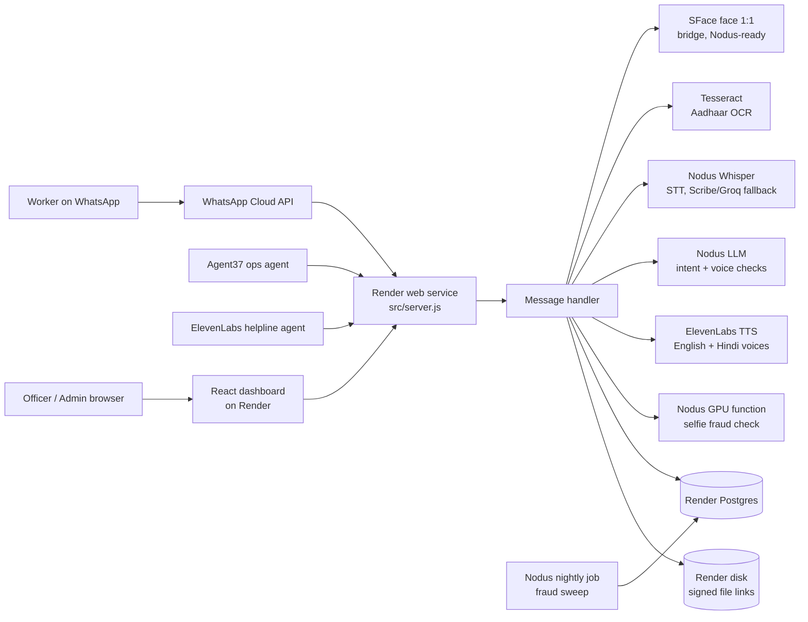

# Nirman Mitra

**Voice-first WhatsApp assistant that helps construction workers build verifiable proof of work days, and lets welfare board officers verify that proof.**

Workers check in daily with a selfie, their location, and a voice note. Each check-in is verified by three independent checks: face, geo-fence, and voice intent. Verified days add up to a digitally signed work certificate. See [PRD.md](PRD.md) for the full product requirements.

### Core Innovation: Triple Verification

Every attendance log is verified through three independent AI channels simultaneously:

| Channel | AI/Cloud Service | What It Catches |
|---|---|---|
| **Face Match** | OpenCV SFace on the face bridge (Nodus-ready; Rekognition optional) | Buddy-punching, fake identities |
| **Geo-Fence** | GPS + Site matching | Off-site check-ins, spoofing |
| **Voice Intent** | Nodus inference (Whisper + gpt-oss-120b), Groq fallback | Fake check-ins, scripted messages, unintelligible audio |
| **Fraud signals** | Nodus Compute (GPU function + nightly job) | Re-sent gallery selfies, photos of screens, mock GPS, phone farms, one person under two numbers |

## Hackyard Build 2026: Sponsor Integrations

| Sponsor | What it does in Nirman Mitra | Code |
|---|---|---|
| **Nodus Compute** | LLM and speech-to-text on Nodus inference. A GPU `analyze_selfie` function on every check-in (pHash + DINOv2 near-duplicate, FaceNet, screen recapture). A nightly fraud-sweep job for mock GPS, impossible travel, phone farms and shared faces | [`nodus/`](nodus/), [`src/providers/llm.js`](src/providers/llm.js), [`src/providers/stt.js`](src/providers/stt.js), [`src/services/fraudSignals.js`](src/services/fraudSignals.js) |
| **ElevenLabs** | Spoken replies in every language with a voice, **including Kannada** (Polly has none). Scribe as STT fallback. The "Mitra Helpline" voice agent on WhatsApp/phone, with its LLM on Nodus | [`src/providers/tts.js`](src/providers/tts.js), [`agents/elevenlabs/`](agents/elevenlabs/), [`src/handlers/helplineRoutes.js`](src/handlers/helplineRoutes.js) |
| **Agent37** | An always-on Welfare Ops Agent: AI triage notes on the review queue (recommendations only), a daily officer digest, and a weekly welfare-scheme refresh for the helpline | [`agents/agent37/`](agents/agent37/), [`src/handlers/agentRoutes.js`](src/handlers/agentRoutes.js) |

See [docs/SPONSOR_PLAN.md](docs/SPONSOR_PLAN.md) for the plan and demo script,
[docs/RENDER_NEON.md](docs/RENDER_NEON.md) for hosting on Render with Neon, and
[docs/NODUS_SWITCH.md](docs/NODUS_SWITCH.md) for running before Nodus access and switching over.

### The Four Zeros

| Principle | How |
|---|---|
| **Zero Literacy** | Voice-first via WhatsApp voice notes + ElevenLabs spoken replies (or native text) |
| **Zero Downloads** | WhatsApp only — no app installation required |
| **Zero Contractor Dependency** | AI self-verification replaces employer sign-off |
| **Zero Typing** | Voice input + camera — no text entry required |

## Architecture



### Deliberate Architectural Decisions

| Decision | Choice | Why Not Alternative |
|---|---|---|
| **Database** | Render Postgres | Same platform and Blueprint as the API. The data helpers keep DynamoDB's API and expressions (`src/utils/postgres.js`), so `DB_BACKEND=dynamodb` still runs the Lambda stack. |
| **Compute** | Render web service + cron job | One always-on Node process (`src/server.js`) runs the same handlers with no cold starts; the Lambda stack stays deployable as a standby. |
| **LLM & STT** | Groq (Whisper + Llama/GPT-OSS) | Amazon Transcribe was too slow (~10-20s polling). Groq Whisper transcribes in ~1 second. |
| **Frontend** | Render static site | Deploys from the same Blueprint (`render.yaml`) as the API, after CI passes. |

### Cost Analysis

| Component | Description | Cost Profile |
|---|---|---|
| Groq Whisper & LLM | Ultra-fast STT and Intent extraction | Extremely low cost / API tokens |
| Render (API, cron, bridge, Postgres, disk) | Hosting and data | About $21/month; the dashboard is a free static site |
| OpenCV SFace | Face enrolment and 1:1 match on the bridge CPU | No per-call cost |
| Tesseract | Aadhaar/passbook OCR in the API process | No per-page cost |
| ElevenLabs | Spoken replies, cached by content on the disk | Plan credits |

### Where Things Run

- **Render:** the API and webhook (`src/server.js`), the reminder cron job, the Nodus fraud bridge,
  the dashboard, Postgres for all data, and a disk for worker media, certificates and cached voice
  replies (`render.yaml`).
- **Faces:** OpenCV SFace on the bridge (`FACE_PROVIDER=bridge`). No AWS is needed;
  `FACE_PROVIDER=rekognition` still works with AWS keys.
- **Nodus, ElevenLabs, Groq:** LLM, speech-to-text, voices and the fraud checks (see above).
- **Backend switches:** `DB_BACKEND` (postgres | dynamodb), `STORAGE_BACKEND` (disk | s3),
  `OCR_PROVIDER` (tesseract | textract) and `TTS_FALLBACK` (none | polly). Each defaults to the
  original AWS service, so `template.yaml` still deploys the Lambda stack as a standby.

## Quick Start

### Prerequisites
- Node.js 20+
- WhatsApp Cloud API App (Meta Developer Console)
- Render account (no AWS needed)
- Groq and ElevenLabs API keys (Nodus optional: see [docs/NODUS_SWITCH.md](docs/NODUS_SWITCH.md))

### Configuration
Copy `.env.example` to `.env` and fill in your values. Never commit real secrets. On Render the
values are set per service (`render.yaml` marks every secret `sync: false`).

### Deploy

**1. Render.** In the Render dashboard choose **New → Blueprint**, pick this repo, and fill in the
secrets it asks for (the values from `.env.example`; leave `NODUS_API_KEY` empty until Nodus
access arrives). It creates:

| Resource | What |
|---|---|
| `nirman-mitra-api` | WhatsApp webhook, all `/api/*` routes, `/files/` links; 1 GB disk |
| `nirman-mitra-reminders` | Proactive reminders and expired-row cleanup, every 15 minutes |
| `nirman-fraud-bridge` | Face enrolment/matching and selfie fraud checks (CPU now, Nodus later) |
| `nirman-fraud-sweep` | Nightly fraud sweep at 02:00 IST (moves to a Nodus job later) |
| `nirman-mitra-admin` | Dashboard / officer portal (static) |
| `nirman-mitra-db` | Postgres for all data (one `items` table, created on first use) |

Then point things at the new URLs: `VITE_API_URL` (dashboard) = the API URL, `PORTAL_URL` and
`FRAUD_SERVICE_URL` (API) = the dashboard and bridge URLs. After that, every push to `main`
deploys once CI passes.

**2. WhatsApp.** In the Meta app set the callback URL to
`https://<nirman-mitra-api host>/webhook/whatsapp`, use the same `WHATSAPP_VERIFY_TOKEN`, and
subscribe to the `messages` field.

**3. Demo data.** Seed sites with `scripts/seed-sites.mjs`, and the fraud scenarios with
`DB_BACKEND=postgres DATABASE_URL=<external URL> node scripts/seed-fraud-demo.mjs`.

**Adaption Visualize.** The dashboard's *Explore in Adaption Visualize* card downloads
pseudonymised check-in and fraud datasets (`/api/admin/export/*.csv`, no names, phone numbers,
Aadhaar details or GPS) to upload to [Adaption Visualize](https://www.adaptionlabs.ai/).

### Run Locally

```bash
npm install
node src/server.js          # API on :3001, in-memory demo store when ENVIRONMENT=dev
                            # (DB_BACKEND=postgres DATABASE_URL=... for a real database)

cd admin-dashboard
npm install
npm run dev                 # proxies /api and /webhook to :3001
```

### Create the First Admin User
```bash
curl -X POST "$API_URL/api/auth/seed" \
  -H "Content-Type: application/json" \
  -d '{"email":"admin@example.com","password":"<strong-password>","name":"Admin","seedSecret":"<AdminSeedSecret>"}'
```

### Demo Mode

The project runs in demo mode by default if `ENVIRONMENT=dev`:
- **Demo Keywords:** Supported phone numbers can trigger quick demo paths.
- **Certificate Threshold:** Set to **3 days** (instead of 90) for quick demonstrations.
- **Voice Fallback:** If audio is too short, mock demo transcriptions are returned.

## Project Structure

```
nirman-mitra/
  ├── PRD.md                    # Product requirements and specs
  ├── template.yaml             # AWS SAM template (API, Lambdas, tables, buckets)
  ├── docs/SPONSOR_PLAN.md      # Hackyard sponsor integration plan + demo script
  ├── nodus/                    # Nodus Compute fraud function, nightly sweep job, HTTP bridge
  ├── agents/
  │   ├── agent37/              # Agent37 Welfare Ops Agent (triage, digest, instructions)
  │   └── elevenlabs/           # ElevenLabs Mitra Helpline agent config + tool
  ├── src/
  │   ├── handlers/             # Lambda entry points (webhook, attendance, certs, admin, agent, helpline API)
  │   ├── services/             # Business logic (registration, document OCR, voice processing)
  │   ├── providers/            # llm.js (Nodus → Groq), stt.js (Nodus → Scribe → Groq), tts.js (ElevenLabs)
  │   ├── middleware/auth.js    # JWT verification for the admin API
  │   ├── stepFunctions/        # AWS Step Functions state machine definitions (ASL)
  │   └── utils/                # Config, data helpers (Postgres/DynamoDB), file storage, WhatsApp client
  └── admin-dashboard/          # React + Vite admin dashboard and verify page
```

## Security & Privacy
- **KMS Encryption:** Sensitive documents like Aadhaar are encrypted at rest.
- **PII Masking:** Only the last 4 digits of Aadhaar are stored in the database.
- **Least-privilege IAM:** Each Lambda function has a dedicated execution role with strict permissions.
- **S3 Public Access Blocked:** All backend buckets are strictly private.

## Team

**StrawHats** | Hackyard Build 2026
